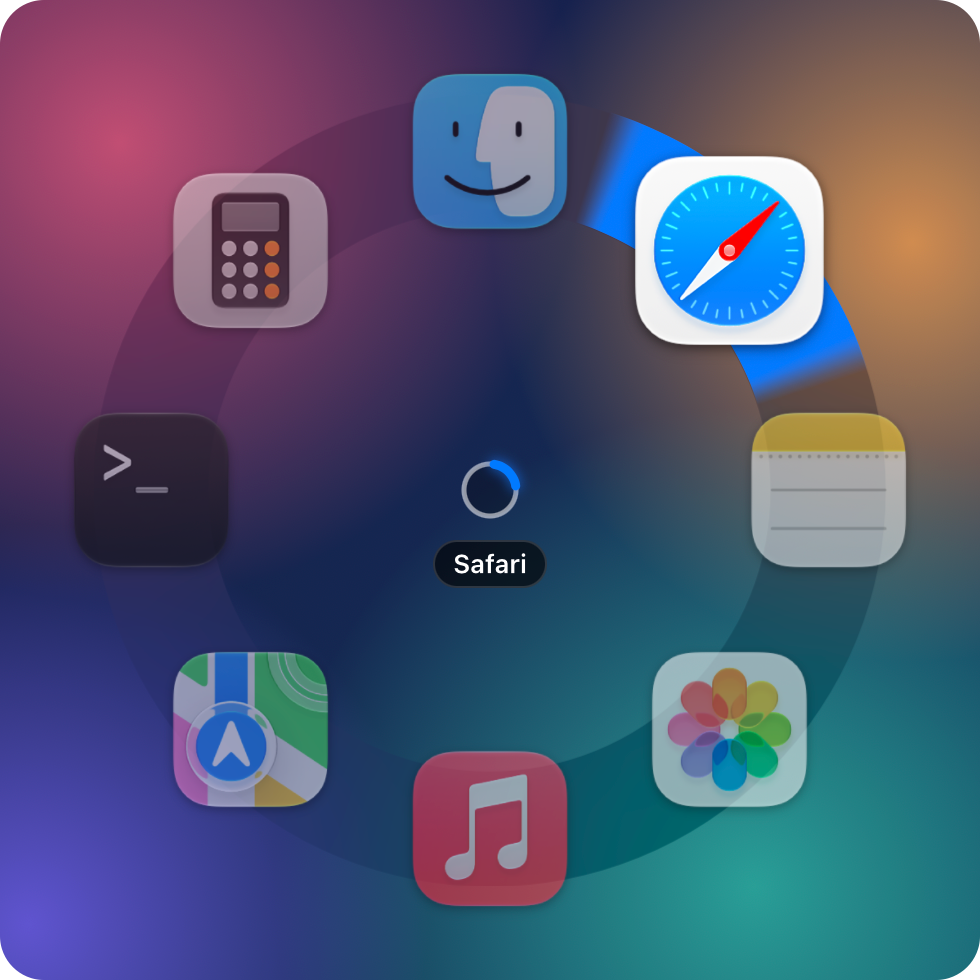

# Ringo

A pie-menu app switcher for macOS, in the spirit of Blender's pie menus.

<p align="center">
  
</p>

Hold the hotkey and your apps fan out in a ring around the cursor. Flick toward
one and let go to switch to it.

- **Hold, flick, release**: switches to the app the cursor points at. You don't
  need to reach the icon; only the direction matters.
- **Release in the middle** cancels. The menu only stays open while the hotkey
  is held.
- **Click** while holding also switches. Right click cancels.

Picking an app that isn't running launches it. Apps show the same badge they
have in the Dock, like an unread count.

## Building

Needs macOS 14 or later, a Swift 6 toolchain (Xcode or the Command Line Tools)
and [just](https://github.com/casey/just).

```bash
just install
```

This builds `build/Ringo.app`, replaces `/Applications/Ringo.app` with it and
restarts the app. The app lives in the menu bar. To start it at login, add it
under System Settings → General → Login Items.

The app doesn't need Accessibility or Input Monitoring permission, except to
stop stray scrolling after a trackpad pick (see Configuration).

Other recipes:

- `just run`: build and run from `build/` without installing
- `just stop`: quit the running app
- `just test`: run the tests
- `just check`: validate your config and list the apps it resolves to

## Configuration

The config lives at `~/.config/ringo/config.toml`, or under `$XDG_CONFIG_HOME`
if that's set. A default is written on first launch. Ringo used to be called
Radial Ring Menu, and a config at the old `radial-ring-menu/config.toml` is
still used while there isn't one at the new place. Changes
are picked up when you save. The menu bar menu has *Open Config…* and
*Preview Menu*, and *Edit Style…* opens a window for trying out the look on a
live preview and writing it to the config. It only changes the settings you
edited, and keeps the rest of the file, comments included.

```toml
hotkey = "option+space"

# How long the icons take to fan out when the menu opens, in milliseconds.
open_animation_ms = 180

# How far the icons are from the cursor, and their size, in points.
[icons]
radius = 110
size = 64
selected_scale = 1.22     # how much bigger the selected app's icon gets
unselected_opacity = 0.55 # how opaque the others are while one is selected
unselected_scale = 1      # and how big, as a fraction of their size (0.2 to 1)

# Colors are "#RRGGBB", or "#RRGGBBAA" where the last two digits are the opacity.

# The grey ring behind the icons: how far its edges are from the cursor, in
# points, and a color laid over it (partly transparent tints the ring, opaque
# replaces it). Defaults to a bit narrower than the icons, so they stick out of
# it, and just the blur.
[outer_ring]
inner_radius = 90
outer_radius = 130
color = "#00000080"

# The part of the ring in the direction of the cursor.
[outer_ring.highlight]
shape = "wedge"       # fills the ring's width and fades out at its ends; or
                      # "bubble", an arc with rounded ends that reach past its width
width = 60            # degrees; defaults to one app's share of the ring, at most 90
fade = 6              # degrees a wedge fades out over; defaults to a tenth of its width
overhang = 0          # points it reaches past both edges of the ring
color = "#FF9500"     # also the glow's; defaults to the system accent color
glow_spread = 0       # points the solid part of the glow reaches past the highlight
glow_blur = 0         # points its edge fades out over
glow_opacity = 0.3    # from 0 to 1

# The small circle in the middle, a translucent white by default.
[inner_ring]
color = "#FFFFFF8C"

# Takes the same settings as the outer ring's highlight. These are its defaults.
[inner_ring.highlight]
shape = "bubble"
width = 72
overhang = 1
glow_blur = 3
glow_opacity = 0.8

# Apps go clockwise, starting at 12 o'clock.
[[apps]]
name = "Safari"                  # looked up in /Applications and the system app folders

[[apps]]
bundle_id = "com.apple.Terminal" # name is optional and overrides the label

[[apps]]
path = "~/Applications/Some App.app"
name = "Some App"

[[apps]]
process = "my-app"               # a running executable that isn't an .app
icon = "~/code/my-app/icon.icns" # any entry can override its icon

[[apps]]
name = "Ghostty"
hide_cursor = true               # hide the cursor after switching to it
```

**Hotkey**: modifiers `cmd`, `shift`, `option` (or `alt`) and `ctrl`, plus one
key: `a`–`z`, `0`–`9`, `space`, `tab`, `return`, `escape`, `f1`–`f20`, arrows
(`left`, `right`, `up`, `down`) or punctuation (`` ` ``, `-`, `=`, `[`, `]`, `;`,
`'`, `,`, `.`, `/`, `\`). Letters and punctuation mean their position on a US
keyboard. Releasing any of the modifiers counts as releasing the hotkey.

A modifier can also be the whole hotkey, either side or just one:
`"option"`, `"left-option"`, `"right-cmd"`, `"left-shift"`, `"right-ctrl"` and
so on. Holding it on its own opens the menu. It stays out of the way of normal
use: pressing it while another modifier is down (like ⌘⌥Esc) doesn't open the
menu, and typing a key or adding a modifier while holding it (like ⌥E) closes
the menu without switching. A good pick is a side you rarely use for shortcuts,
like `"right-cmd"` or `"left-option"`. Left/right only works for modifiers on
their own, not in combos like `option+space`.

**Mouse button**: `mouse_button = 5` also opens the menu while that mouse button
is held, like the hotkey. Buttons count from 1: 1 is left, 2 right, 3 middle,
and 4 and 5 are usually the side buttons, but mice differ, so use *Identify
Mouse Button…* in the menu bar menu and press the button to find its number.
The button stops doing anything else, like going forward in a browser. This
needs the Accessibility permission, and catches the button at the lowest level
macOS allows, so remappers like LinearMouse don't get to change it first.

**Trackpad**: `trackpad_fingers = 3` (or 4 or 5) also opens the menu when that
many fingers rest on the trackpad. Slide them toward an app and lift to switch;
lifting without moving cancels, and adding a finger cancels too. The fingers
have to settle for a moment first, so gestures with more fingers don't flash the
menu. macOS's own gestures with the same number of fingers still fire, so move
those to another count in System Settings → Trackpad → More Gestures if they get
in the way. This reads the trackpad through Apple's private MultitouchSupport
framework, like BetterTouchTool does, since apps in the background don't get
touch events otherwise.

Unless a system gesture uses the same fingers, macOS also turns their movement
into a scroll, which would coast on into the app you just switched to. Give the
app the Accessibility permission (it asks on launch) and it drops that scroll.
Builds are signed with your Apple Development certificate when you have one, so
the permission survives rebuilds; with ad-hoc signing you'd have to grant it
again after every `just install`.

**Cursor**: after switching, the cursor moves to the middle of the app's front
window, once the app is in front. Set `move_cursor_to_window = false` to leave it
where it is. It also stays put if you move the mouse before the window shows
up, or if no window does within a couple of seconds.

Set `hide_cursor = true` on an app to hide the cursor after switching to it,
handy for a terminal where you only type. It comes back when you move the mouse
or click, when another app comes to the front, or when the menu opens. This uses
a private WindowServer setting, since apps in the background can't hide the
cursor otherwise.

**Menu bar icon**: `show_menu_bar_icon = false` hides the icon. Everything else
keeps working, and the config is still reloaded when you save it. To reach the
menu, open the app again while it's running (from Finder, Spotlight or
`open -a Ringo`): the icon comes back until the config is next
reloaded.

**Apps**: each entry needs a `name`, `bundle_id`, `path` or `process`.

`process` is for apps that aren't `.app` bundles, like a GUI app started with
`cargo run`. It matches a running process by name and switches to it, but can't
launch it, so picking it when it isn't running just beeps. These show the
generic executable icon unless you set `icon`: an app that sets its Dock icon
at runtime hands the image straight to the Dock, and nothing can read it back.

`icon` takes an image file (PNG, ICNS, PDF, ...) or an `.app` to borrow the
icon from, and works on any entry. Changes to the image file itself are picked
up the next time the config is reloaded.

To find an app's bundle ID:

```bash
osascript -e 'id of app "Safari"'
```

If there are more apps than fit around the ring, the radius grows to make room,
and the grey ring behind the icons grows by the same amount.

**Highlights**: both rings light up in the direction of the cursor, and both
highlights take the same settings. So the outer one can look exactly like the
inner one by copying the inner one's defaults: `shape = "bubble"`, `width = 72`,
`overhang = 1`, `glow_blur = 3` and `glow_opacity = 0.8`. The glow works like
CSS's `box-shadow`: `glow_spread` grows it with a hard edge, and `glow_blur`
softens that edge.

## Command line

```
Ringo [--config <path>] [--check] [--preview]
```

`--check` validates the config and exits. `--preview` opens the menu as soon as
the app starts.
